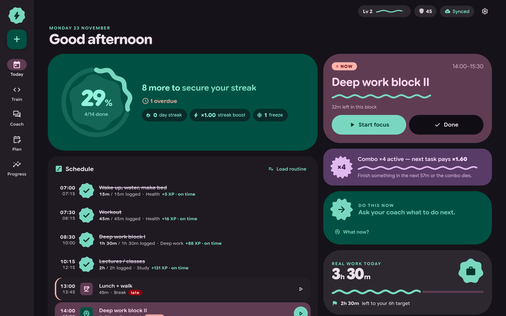
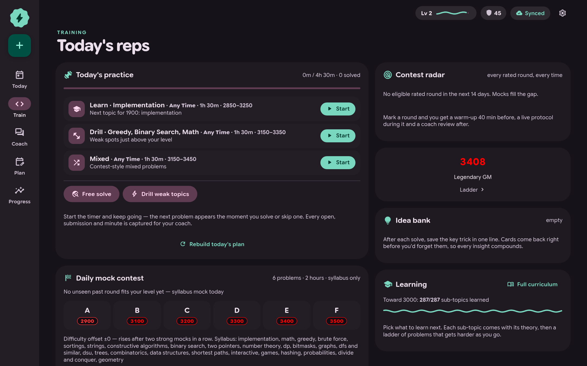
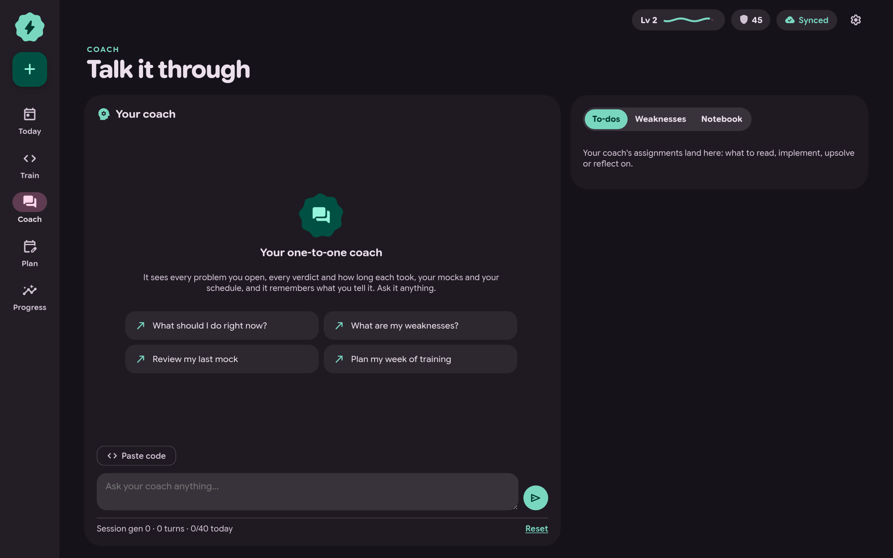
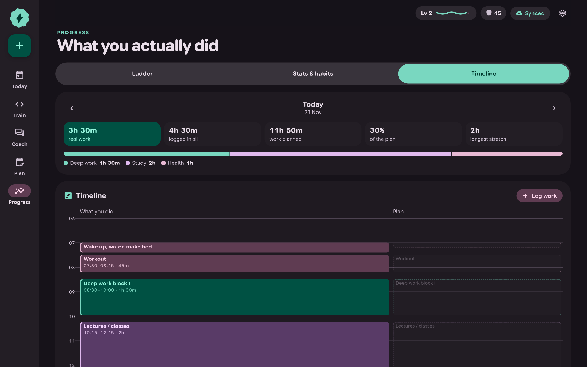
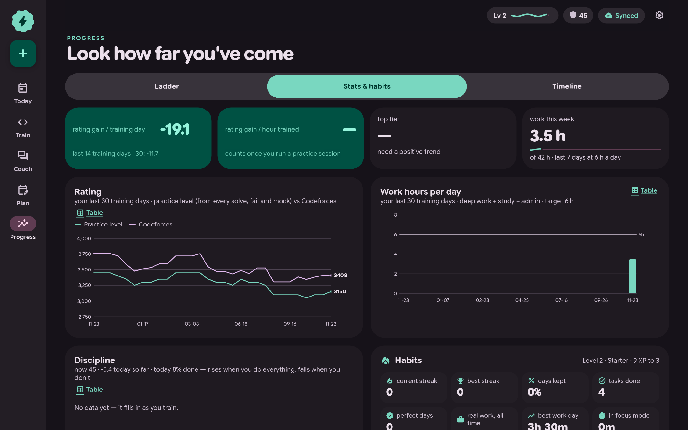
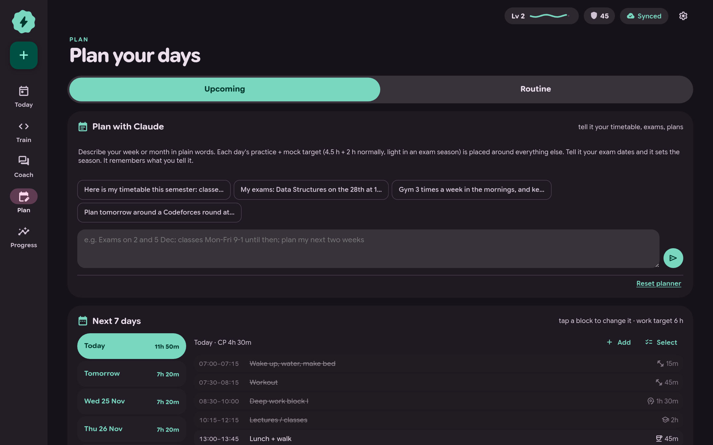
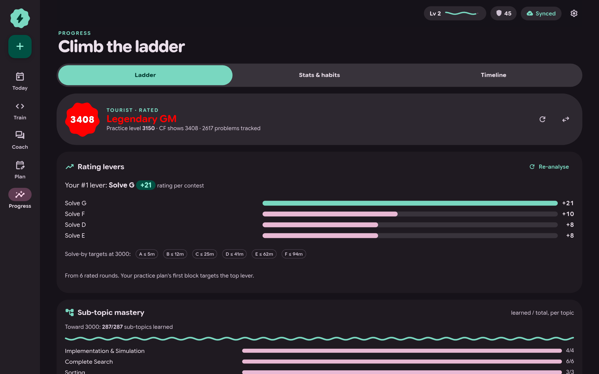

# Momentum

A strict daily planner and Codeforces trainer that runs in your browser and only rewards real work.
It comes with a personal Claude coach and a Claude day planner that run through the Claude Code CLI on your own machine.

Momentum is a local app: a zero-dependency Python server on `127.0.0.1` serves a React PWA and stores everything in a
JSON file on your disk. No accounts, no cloud, no telemetry.



## What it does

**Planner**
- **XP is real work.** XP = minutes worked × category weight (deep work and study 1.0, admin 0.6, health 0.4, life 0.3,
  breaks 0) × earned multipliers (on time, combo, streak, locked plan). Nothing is random.
- **Today:** your schedule with a live "now" card, focus and Pomodoro timers, combos, streaks, quests and goals. Tasks
  you finish without a timer ask when you really did them.
- **Timeline:** what you actually did, side by side with what you planned. Overlaps count once, midnight is split
  correctly, and untimed tasks show as dashed blocks you can tap to log.
- **Plan:** describe your week in plain words (classes, exams, gym) and the Claude planner lays out blocks, shows a
  diff preview, and applies or undoes it.
- **Exam seasons:** tell the planner or Settings your exam dates and training targets drop (45 min of practice, no
  daily mock, rated rounds optional) while study days count towards discipline.

**Codeforces trainer**
- Link a handle and your submission history becomes an Elo-style rating per topic.
- Daily practice sessions are picked for growth: weak topics just above your level, fluency at your level, stretches,
  upsolves and spaced re-solves. Accepted submissions on Codeforces are detected automatically.
- A daily **mock contest** (6 problems, 2 hours) from topics you've learned, or an unseen past round taken as a virtual
  participation, scored as a performance rating.
- A **contest radar** for upcoming rated rounds, a live-contest overlay, a 72-hour upsolve queue, an idea bank with
  spaced repetition, and a curriculum with curated reading per topic.

**Claude coach**
- One long-lived Claude Code conversation that sees every problem you open, every verdict, time to AC, hints used,
  your mocks, hours and discipline.
- It answers in chat, sets a "Do this now" instruction, adds concrete to-dos to Today, keeps a weakness board and a
  notebook, reviews pasted code (hints first), and designs your practice sessions within fixed bounds.

**Progress**
- Rating vs. practice level, work hours, discipline score, habits, a topic ladder and more, all with table views.

| | |
|---|---|
|  |  |
|  |  |
|  |  |

Keyboard shortcuts: `1`–`5` switch tabs, `n` adds a task, `Space` starts or pauses the timer, `m` minimises it,
`/` focuses the coach chat, `?` lists them all.

## Requirements

- Node.js 20+ (to build the front end)
- Python 3.10+ (the server uses only the standard library)
- Optional, for the coach and planner: [Claude Code](https://docs.claude.com/en/docs/claude-code) installed and
  logged in on the same machine. Everything else works without it.

## Quick start

```bash
git clone https://github.com/irrationalpi2008-bot/momentum.git
cd momentum
npm install
npm run build          # type-checks and builds dist/
python3 server.py      # serves the app on http://localhost:8787 and prints your server key
```

Open <http://localhost:8787>, go to **Settings → Local server**, paste the key that `server.py` printed and press
**Connect**. The key is also saved in `data/sync_key.txt`.

Chrome and Edge can install it as an app (the install button is in Settings), and it keeps working offline.

### Start the server automatically (systemd user service)

```bash
mkdir -p ~/.config/systemd/user
cp contrib/momentum.service ~/.config/systemd/user/   # edit the path inside first
systemctl --user daemon-reload
systemctl --user enable --now momentum
```

## Configuration

| Setting | Default | What it does |
|---|---|---|
| `--port` | `8787` | Port to listen on (always `127.0.0.1`) |
| `MOMENTUM_DATA` | `./data` | Where state, backups and Claude sessions are stored |
| `MOMENTUM_KEY` | random, saved to `data/sync_key.txt` | Server key the browser needs |
| `MOMENTUM_COACH_MODEL` / `MOMENTUM_PLANNER_MODEL` | `opus` | Model passed to `claude -p` |
| `MOMENTUM_CLAUDE_MAX_DAY` | 40 coach / 30 planner | Turn cap per session per day |
| `MOMENTUM_CLAUDE_TIMEOUT` | `900` | Timeout for one Claude turn, in seconds |
| `MOMENTUM_CLAUDE_BUDGET` | unset | Passed to `claude -p --max-budget-usd` |
| `MOMENTUM_CLAUDE_BIN` | `claude` | Path to the Claude Code binary (point at a stub for testing) |
| `MOMENTUM_DIST` | `./dist` | Built front end to serve |

Data lives in `data/state.json`, with a daily backup in `data/backups/` (the last 14 days). Claude sessions live in
`data/claude/`. If a conversation is ever lost, the server starts a new one and re-seeds it from the coach's notebook.

## Development

```bash
npm run dev                      # Vite on http://localhost:5181; point Settings at a running server.py
npm test                         # scenario tests (node, no browser needed)
python3 tests/server_check.py    # server checks
```

The first test run downloads the public Codeforces problem set into `tests/fixtures/` (git-ignored).

### Layout

```
server.py         HTTP server: static files, state API, backups, Claude session endpoints
sessions.py       long-lived claude -p sessions (coach and planner)
prompts.py        system prompts and output schemas
src/              React app (store.ts = state and merge rules, train.ts = trainer, coach.ts, planner.ts, season.ts …)
curriculum/       topic curriculum with curated problems and reading
tests/            scenario suites and server checks
contrib/          systemd unit template
```

## Privacy

Everything stays on your machine. The browser talks only to your local server, Codeforces' public API (for your
handle's submissions and the problem set) and Google Fonts. The coach and planner send your training data to Claude
through your own Claude Code login.

## License

[MIT](LICENSE)
